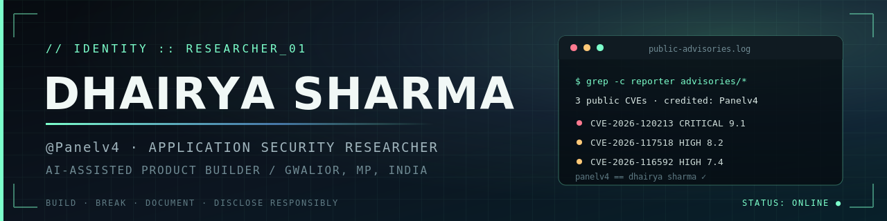

<div align="center">
  

  <br /><br />

  [`github.com/Panelv4`](https://github.com/Panelv4) &nbsp;·&nbsp;
  [`hackerone.com/vibecoder`](https://hackerone.com/vibecoder) &nbsp;·&nbsp;
  [`panelv4.github.io/DhairyaSharma`](https://panelv4.github.io/DhairyaSharma/) &nbsp;·&nbsp;
  [`dhairyasharma7101@gmail.com`](mailto:dhairyasharma7101@gmail.com)

  <br />

  <sub><b>Dhairya Sharma</b> · <code>@Panelv4</code> · <code>vibecoder</code> (HackerOne) · Gwalior, Madhya Pradesh, India</sub>

  <br />

  <sub>[`ALIASES.md`](ALIASES.md) &nbsp;·&nbsp; [`FINDINGS.md`](FINDINGS.md) &nbsp;·&nbsp; [`IDENTITY-ATTESTATION.md`](IDENTITY-ATTESTATION.md)</sub>
</div>

---

```text
$ whoami
Dhairya Sharma  →  Panelv4 (GitHub)  →  vibecoder (HackerOne)  →  reporter on 3 public CVEs

$ cat focus.txt
AI-assisted product building  ·  deterministic systems  ·  application security
HTTP parsing · URL normalisation · proxy & cache boundaries · authorisation
responsible disclosure · evidence-based technical writing

$ echo $STATUS
open to AI-assisted product building, technical generalist work & AppSec research
```

## 🔎 Name ↔ handle ↔ CVE attribution

> **The three public CVE records below list the reporter as `Panelv4`. `Panelv4` is me — Dhairya Sharma. My HackerOne handle `vibecoder` is also me.**
>
> | Identifier | Platform | Belongs to |
> | --- | --- | --- |
> | `Dhairya Sharma` | real name | **Dhairya Sharma** |
> | `Panelv4` | GitHub | **Dhairya Sharma** |
> | `vibecoder` | HackerOne | **Dhairya Sharma** |
>
> **`Panelv4` = `vibecoder` = Dhairya Sharma.** In plain text for crawlers: Dhairya Sharma is also known as Panelv4 on GitHub and vibecoder on HackerOne; both accounts are owned by Dhairya Sharma. Full mapping: [`ALIASES.md`](ALIASES.md).
>
> | If you searched for | The reporter is |
> | --- | --- |
> | `CVE-2026-120213` | **Dhairya Sharma** (GitHub: `Panelv4` · HackerOne: `vibecoder`) |
> | `CVE-2026-117518` | **Dhairya Sharma** (GitHub: `Panelv4` · HackerOne: `vibecoder`) |
> | `CVE-2026-116592` | **Dhairya Sharma** (GitHub: `Panelv4` · HackerOne: `vibecoder`) |
>
> Full technical write-ups and credit links: [`Panelv4/CVE-Research-Dhairya-Sharma`](https://github.com/Panelv4/CVE-Research-Dhairya-Sharma)

---

## 🛡️ Public vulnerability disclosures — 3 CVEs

All three advisories are published by their maintainers, carry a CVE ID, and explicitly credit **Panelv4 / Dhairya Sharma** as reporter. Severity, CVSS, affected versions and fixed versions below follow those public GitHub Security Advisories.

| # | CVE | Advisory | Package | Severity | CVSS v3.1 | Affected | Fixed in | Reporter |
| :-: | --- | --- | --- | :-: | :-: | --- | --- | --- |
| 01 | [`CVE-2026-120213`](https://nvd.nist.gov/vuln/detail/CVE-2026-120213) | [`GHSA-h3vp-4jfr-v364`](https://github.com/fastify/fastify-http-proxy/security/advisories/GHSA-h3vp-4jfr-v364) | `@fastify/http-proxy` | 🔴 Critical | **9.1** | `>= 9.0.0, < 11.6.6` | `11.6.6` | **Dhairya Sharma (`Panelv4`)** |
| 02 | [`CVE-2026-117518`](https://nvd.nist.gov/vuln/detail/CVE-2026-117518) | [`GHSA-vp2r-3vgv-32g9`](https://github.com/fastify/fastify-reply-from/security/advisories/GHSA-vp2r-3vgv-32g9) | `@fastify/reply-from` | 🟠 High | **8.2** | `<= 12.8.0` | `12.8.1` | **Dhairya Sharma (`Panelv4`)** |
| 03 | [`CVE-2026-116592`](https://nvd.nist.gov/vuln/detail/CVE-2026-116592) | [`GHSA-mqg3-3v4r-cm32`](https://github.com/nodejs/undici/security/advisories/GHSA-mqg3-3v4r-cm32) | `undici` | 🟠 High | **7.4** | `7.30.1`, `8.12.2–8.12.3` | `7.30.2`, `8.12.4` | **Dhairya Sharma (`Panelv4`)** + `w116tjb` |

### `CVE-2026-120213` — decoded route-parameter prefix escape in `@fastify/http-proxy`

**Published 02 Nov 2026 · Critical · CVSS 9.1** · `CVSS:3.1/AV:N/AC:L/PR:N/UI:N/S:U/C:H/I:H/A:N` · CWE-22, CWE-436

When an application uses a **parameterised `prefix` + `rewritePrefix`** to pin clients to a fixed upstream path, the plugin substitutes URL-decoded route parameters into `rewritePrefix` **without re-encoding them**. A parameter value containing an encoded `/` together with `#` or `?` therefore decodes into real separators: extra upstream path segments are injected and the mandatory suffix that `rewritePrefix` was meant to enforce is stripped — **without any `..` traversal**. An unauthenticated remote attacker can reach upstream locations outside the intended prefix, producing **SSRF or authorisation bypass** in the proxied service depending on upstream behaviour.

- **Affected:** `@fastify/http-proxy` `>= 9.0.0` and `< 11.6.6` · **Fixed:** `11.6.6` · **Workaround:** none — upgrade only
- **Credits:** reporter `Panelv4` (**Dhairya Sharma**); remediation `UlisesGascon`, `mcollina`
- **Sources:** [GHSA-h3vp-4jfr-v364](https://github.com/fastify/fastify-http-proxy/security/advisories/GHSA-h3vp-4jfr-v364) · [NVD](https://nvd.nist.gov/vuln/detail/CVE-2026-120213) · [OpenJS CNA](https://cna.openjsf.org/security-advisories.html)

### `CVE-2026-117518` — backslash dot-segment prefix escape in `@fastify/reply-from`

**Published 02 Nov 2026 · High · CVSS 8.2** · `CVSS:3.1/AV:N/AC:L/PR:N/UI:N/S:U/C:H/I:L/A:N` · CWE-22

`buildURL()` validated proxy paths against **forward-slash dot-segments only**, then resolved the target with the WHATWG `URL` parser, which normalises backslash and `%5c` to `/` on `http`, `https`, `ws` and `wss`. A path using backslash dot-segments (`%5c..%5c` or raw `\..\`) bypassed the traversal check and resolved to a different upstream path. Applications that scope proxying to an upstream prefix (e.g. `reply.from('/v1/public/' + req.params['*'])`) or rely on Fastify route guards in front of `reply.from()` can have an unauthenticated request **escape the intended prefix** and reach other upstream endpoints. The fix normalises backslashes and rejects any path whose segments resolve to `.` or `..`, plus control characters and ambiguous whitespace, before URL construction.

- **Affected:** all releases `<= 12.8.0` · **Fixed:** `12.8.1` · **Workaround:** none
- **Credits:** reporter `Panelv4` (**Dhairya Sharma**); remediation developer `mcollina`; reviewer `UlisesGascon`
- **Sources:** [GHSA-vp2r-3vgv-32g9](https://github.com/fastify/fastify-reply-from/security/advisories/GHSA-vp2r-3vgv-32g9) · [NVD](https://nvd.nist.gov/vuln/detail/CVE-2026-117518) · [OpenJS CNA](https://cna.openjsf.org/security-advisories.html)

### `CVE-2026-116592` — cache poisoning & cross-user disclosure through intermediate redirects in `undici`

**Published 05 Nov 2026 · High · CVSS 7.4** · `CVSS:3.1/AV:N/AC:H/PR:N/UI:N/S:U/C:H/I:H/A:N` · CWE-346, CWE-524

With an **originless `Agent`**, a **shared cache**, and interceptors composed as `compose(redirect(), cache())`, undici decided whether to store the final response under the original request key by inspecting **only the final redirect hop**. Properties of intermediate suppressed hops were lost, so an earlier fix (CVE-2026-109829) could be bypassed: a redirect bouncing through an untrusted origin and back is still cached under the trusted key; an intermediate hop's `Vary` is dropped, so a response varying on `Authorization` or `Cookie` can be served to a different user; and an intermediate `no-cache`, `Vary: *` or default-uncacheable status is ignored, laundering a non-storable redirect into a cacheable entry. Poisoned entries also persist across restarts in `SqliteCacheStore`. **Impact:** cache poisoning or cross-user disclosure of user-specific responses. Origin-bound `Client`/`Pool` dispatchers and the reverse composition `compose(cache(), redirect())` are not affected.

- **Affected:** `undici` `7.30.1` and `8.12.2–8.12.3` · **Fixed:** `7.30.2` and `8.12.4` (every hop must stay on the cache-key origin; per-hop storability/freshness applied; `Vary` unioned; `SqliteCacheStore` format bumped)
- **Workarounds:** compose as `compose(cache(), redirect())`, use per-origin dispatchers/stores, or disable shared caching on redirect-capable requests
- **Credits:** reporters `Panelv4` (**Dhairya Sharma**) and `w116tjb`; remediation `mcollina`, `UlisesGascon`
- **Sources:** [GHSA-mqg3-3v4r-cm32](https://github.com/nodejs/undici/security/advisories/GHSA-mqg3-3v4r-cm32) · [NVD](https://nvd.nist.gov/vuln/detail/CVE-2026-116592) · [OpenJS CNA](https://cna.openjsf.org/security-advisories.html)

> **Disclosure integrity:** only these three public advisories are claimed as CVEs. Private coordinated-disclosure reports and self-deployed lab observations are deliberately not described here, and no private reproduction steps, endpoints or evidence are published. Lab observations are not presented as vendor-confirmed vulnerabilities. See the [attribution & correction request](https://github.com/Panelv4/CVE-Research-Dhairya-Sharma#credit-correction) if you maintain one of these records.

---

## 📑 Findings list — links that name Dhairya Sharma on GitHub

Every link below is a **GitHub page whose title and first line name Dhairya Sharma** as the reporter, so searching any finding ID lands on a GitHub result carrying the real name rather than only the handle.

| Finding | GitHub write-up (link text = Dhairya Sharma) | Official record |
| --- | --- | --- |
| `CVE-2026-120213` | [**Dhairya Sharma — CVE-2026-120213 write-up**](https://github.com/Panelv4/CVE-Research-Dhairya-Sharma/blob/main/cves/CVE-2026-120213.md) | [GHSA-h3vp-4jfr-v364](https://github.com/fastify/fastify-http-proxy/security/advisories/GHSA-h3vp-4jfr-v364) · [NVD](https://nvd.nist.gov/vuln/detail/CVE-2026-120213) |
| `CVE-2026-117518` | [**Dhairya Sharma — CVE-2026-117518 write-up**](https://github.com/Panelv4/CVE-Research-Dhairya-Sharma/blob/main/cves/CVE-2026-117518.md) | [GHSA-vp2r-3vgv-32g9](https://github.com/fastify/fastify-reply-from/security/advisories/GHSA-vp2r-3vgv-32g9) · [NVD](https://nvd.nist.gov/vuln/detail/CVE-2026-117518) |
| `CVE-2026-116592` | [**Dhairya Sharma — CVE-2026-116592 write-up**](https://github.com/Panelv4/CVE-Research-Dhairya-Sharma/blob/main/cves/CVE-2026-116592.md) | [GHSA-mqg3-3v4r-cm32](https://github.com/nodejs/undici/security/advisories/GHSA-mqg3-3v4r-cm32) · [NVD](https://nvd.nist.gov/vuln/detail/CVE-2026-116592) |

| Name / handle link | Destination |
| --- | --- |
| [**Dhairya Sharma = Panelv4 = vibecoder**](https://github.com/Panelv4/Panelv4/blob/main/ALIASES.md) | Alias resolution file |
| [**Dhairya Sharma — findings index**](https://github.com/Panelv4/CVE-Research-Dhairya-Sharma/blob/main/FINDINGS.md) | `FINDINGS.md` |
| [**Dhairya Sharma (Panelv4)**](https://github.com/Panelv4) | GitHub profile, display name |
| [**Dhairya Sharma (vibecoder)**](https://hackerone.com/vibecoder) | HackerOne profile |
| [**Dhairya Sharma — identity attestation**](https://github.com/Panelv4/Panelv4/blob/main/IDENTITY-ATTESTATION.md) | Signed statement from `@Panelv4` |

> Private coordinated-disclosure reports, self-deployed lab observations and review items are **not** linked here: no reproduction steps, endpoints, screenshots or confidential evidence are published, and they are not claimed as CVEs.

---

## 📦 Repositories — all 12 public repos

> A single index of everything on [`github.com/Panelv4`](https://github.com/Panelv4?tab=repositories). Descriptions reflect what is actually in each repository, including prototypes and early experiments.

| Repository | Stack | What it is | State |
| --- | --- | --- | --- |
| [`Nayaya`](https://github.com/Panelv4/Nayaya) | Python | Deterministic rules-as-code legal analysis engine + citizen case-reporting portal | 🚩 Flagship |
| [`aegisreview-ai-v2`](https://github.com/Panelv4/aegisreview-ai-v2) | Python | Offline static security analysis: 53 rules, SARIF, CI gate | 🧩 Team / collaborative |
| [`OPS-prod`](https://github.com/Panelv4/OPS-prod) | TypeScript | OpsPilot release-candidate: agency engagement → invoice → payment workspace | 🧪 Release candidate |
| [`OPS-system`](https://github.com/Panelv4/OPS-system) | TypeScript, Next.js | OpsPilot Next.js/Drizzle foundation with sessions, roles, tenant scoping | 🏗️ Foundation |
| [`ops`](https://github.com/Panelv4/ops) | Python, Flask | Original OpsPilot ERP / CRM / HRMS all-in-one prototype | 🧪 Prototype |
| [`Light`](https://github.com/Panelv4/Light) | React, JavaScript | AI companion with side-by-side chat + HTML preview sandbox | 🧪 Prototype |
| [`Social-Application-`](https://github.com/Panelv4/Social-Application-) | Flask, SQLite | Saransh Physiotherapy practice website with appointment booking + admin | 🧪 Prototype |
| [`app.run`](https://github.com/Panelv4/app.run) | Python, Flask | Small Flask experiment auto-extracting a zipped brand asset pack | 🌱 Early experiment |
| [`Dhairya-subdoamin`](https://github.com/Panelv4/Dhairya-subdoamin) | HTML | Minimal static HTML scratchpad / placeholder | 🌱 Early experiment |
| [`Pishing`](https://github.com/Panelv4/Pishing) | Python | Early lab demo of fake-login credential-capture mechanics — educational only | ⚠️ Archive / remove |
| [`ScriptDefaceV10`](https://github.com/Panelv4/ScriptDefaceV10) | HTML | Forked third-party defacement demo page | ⚠️ Fork / archive |
| [`Deface-Webdav`](https://github.com/Panelv4/Deface-Webdav) | Python 2, HTML | Forked third-party WebDAV/Termux lab script | ⚠️ Fork / archive |

### 🚩 [`Nayaya`](https://github.com/Panelv4/Nayaya) — deterministic Rules-as-Code legal analysis

Flagship project. `nyayacode` is a dependency-free Python standard-library engine that **encodes a statute as data and makes the encoding prove itself**: selected Bharatiya Nyaya Sanhita 2023 provisions (ss. 100–105 and exceptions) and Motor Vehicles Act 1988 s. 185 become explicit, versioned rule packs. The same pack and facts always produce the same decision and digest — no model, no inference, no network call.

- Exhaustive analysis of declared fact spaces: gaps, undeclared contentions, designed overrides, unreachable provisions, ambiguity sensitivity
- Amendment-impact comparisons showing exactly which decisions change when a rule pack changes, with minimal witness examples
- The BNS homicide pack covers **10,752 distinct cases**; repealing Exception 4 moves **256** decisions (2.38%), all `culpable_homicide → murder`
- Citizen case-reporting portal concept: case reporting, revisions, human-gated disclosure, evidence-to-fact workflow, provenance-oriented audit records
- Reported test coverage: 43 library tests, 125 portal tests, 150 end-to-end HTTP checks
- **Limitations:** statutory packs are marked unreviewed and unvalidated by legal professionals; exhaustive analysis proves consistency only within the declared fact space, not legal correctness; the portal is a research prototype, not legal advice

A separate **graded uncertainty module** (TRUE / FALSE / MAYBE / MIGHT_BE / MIGHT_NOT_BE / MAYBE_NOT mapped to UNKNOWN, fail-closed so uncertainty never becomes an established fact) is described in my portfolio as a standalone experiment and possible Nayaya extension — it is not integrated and not published as its own repo.

### 🧩 [`aegisreview-ai-v2`](https://github.com/Panelv4/aegisreview-ai-v2) — deterministic static security analysis

An offline SAST tool: **53 rules, 22 languages, 43 CWEs**, taint/data-flow traces, a weighted 0–100 risk score, HTML/Markdown/SARIF 2.1.0 reports and a CI policy gate that can block a merge. No API key, no LLM, no network calls — the same input always produces the same report. The 2.0 rebuild replaced an earlier Flask/HTML shell that had routes but no analysis code with a single FastAPI app serving both API and UI, plus a real `Scan` + `Finding` data model with triage state and history. Collaborative/team project — individual contribution is not claimed exclusively.

### 🏢 OpsPilot family — [`ops`](https://github.com/Panelv4/ops) · [`OPS-system`](https://github.com/Panelv4/OPS-system) · [`OPS-prod`](https://github.com/Panelv4/OPS-prod)

One product idea explored three times, each repo documenting its own limits honestly:

- **`ops` (Flask, Python):** the original prototype — CRM, HRMS, finance, inventory, tasks, AI assistant and analytics in one dashboard, instead of buying a dozen disconnected tools.
- **`OPS-system` (Next.js App Router, TypeScript, PostgreSQL, Drizzle ORM):** a working foundation with registration/login/logout, salted scrypt password hashing, server-side sessions, seven role-based permission policies, tenant-scoped API queries and a database-derived dashboard. Explicitly **not** a complete production ERP: no billing, email delivery, member invitations or background-job engine; docs include unfinished features, security notes, audits and a feature matrix.
- **`OPS-prod` (TypeScript):** a local release candidate for small service agencies — bring in a customer, scope a project, log delivery time, issue an invoice, record a payment, see what remains to collect. Ships `PRODUCTION_READINESS.md`, a deployment runbook and a disposable Docker rehearsal (`scripts/rehearse-compose.sh`). Marked **not approved for customer data or paid launch**; `/demo` is a disposable browser walkthrough.

### 💡 [`Light`](https://github.com/Panelv4/Light) — AI companion + interactive development prototype

A split-interface concept combining an AI chat experience with a browser-like sandbox / HTML preview, aiming to shorten the path from a conversation to a visible interface. React + TanStack Router navigation, streaming responses through an xAI API integration, and an iframe-based HTML preview for iterating on generated interfaces. Adapted/vendored components come from an MIT-licensed project (`agent-sprite-forge`, per `SOURCE.md`) and are **not** claimed as wholly original. Prototype, not a hosted production development environment.

### 🩺 [`Social-Application-`](https://github.com/Panelv4/Social-Application-) — physiotherapy appointment platform

A production-style Flask + SQLite practice website with a fully custom responsive front-end (no CSS framework): home, doctor bio, eight service pages with FAQs, a validated appointment form that stores requests and returns a reference code, a health-library blog, contact page with map, and an admin dashboard to triage bookings and messages. A workflow prototype — not connected to a live clinic, not storing real patient data, and not intended for clinical use.

### 🌱 Early experiments & archived material

- **`app.run`** — a tiny Flask app that auto-extracts `dns_brand_asset_pack_2023.zip`, locates a PNG and renders an inline HTML template with `render_template_string`. A minimal asset-serving experiment.
- **`Dhairya-subdoamin`** — a two-file static HTML scratchpad (`Hi.html`, README) kept as an early placeholder. The name contains a typo; rename or archive.
- **`Pishing`**, **`ScriptDefaceV10`**, **`Deface-Webdav`** — early offensive-tooling experiments, two of them forks of third-party repositories. They are **not** featured work, are not part of my research portfolio, and are kept only as legacy material. `Pishing` demonstrates fake-login credential capture; it should be **deleted or made private**, not run or shared. The two defacement repos are forked third-party code and are best removed. None of them is a CVE, a bounty finding or a research claim.

---

## 🧰 Stack & working style

| | |
| --- | --- |
| **Languages** | Python · JavaScript / TypeScript · HTML / CSS · C · C++ |
| **Building** | Flask · React · TanStack Router · Next.js · PostgreSQL / SQLite · Docker · AI-assisted implementation |
| **Security** | HTTP request parsing · URL & path normalisation · reverse-proxy boundaries · redirects · shared-cache correctness · API authorisation · privacy boundaries · developer-tooling authentication |
| **Method** | Understand the problem → decompose into workflows/data/interfaces → direct AI-assisted implementation → review generated output → test normal, edge and failure paths → record what stays unverified → iterate on evidence |

> AI coding tools materially accelerated implementation across several projects. My contribution is product direction, problem decomposition, requirements, implementation guidance, test design, review and validation. Adapted third-party components are identified rather than claimed as original work. Nothing here implies production deployment, customer adoption, legal correctness, a security certification or professional employment.

---

## 📬 Contact

**Dhairya Sharma** (a.k.a. `Panelv4` / `vibecoder`) · Gwalior, Madhya Pradesh, India · [`@Panelv4`](https://github.com/Panelv4) · [`vibecoder` on HackerOne](https://hackerone.com/vibecoder) · [`DhairyaSharma` site](https://panelv4.github.io/DhairyaSharma/) · [dhairyasharma7101@gmail.com](mailto:dhairyasharma7101@gmail.com)

Interested in **AI-assisted product building, technical generalist work, and application-security research** inside an existing product or engineering team.

<sub>Public-facing profile — direct phone number and school details intentionally omitted. Last updated November 2026.</sub>

---

<div align="center">
  <sub>🧪 <b>Build · Break · Document · Disclose responsibly</b> &nbsp;·&nbsp; 3 public CVEs &nbsp;·&nbsp; 12 public repositories &nbsp;·&nbsp; <code>Panelv4 = vibecoder = Dhairya Sharma</code></sub>
</div>
